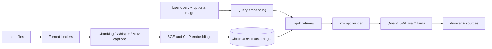

# Nexa AI: Local Multimodal RAG Chatbot

Nexa AI is a fully local chatbot that answers questions about your own **PDF, Word, Excel, CSV, image, audio and video** files using Retrieval-Augmented Generation (RAG). Everything runs on your computer: after the models are downloaded once, no file or question leaves your machine.

> Built as a project for *Deep Learning for Data Analytics (BCSML0555B)*, B.Tech CSE (Data Science), NIET, Greater Noida.


## Features

- **One chat for every file type:** PDF, DOCX/DOC, XLSX/XLS, CSV, TXT/MD, images, audio and video.
- **Fully local and private:** Ollama runs the language model, and embeddings, transcription and the vector database run in Python on your machine.
- **Multimodal retrieval:** images and video frames are captioned by a vision-language model and also embedded with CLIP; attach an image to your question to search with it.
- **Speech support:** audio and video soundtracks are transcribed with Whisper, with timestamps.
- **Cited answers:** every answer lists its sources (file, page, sheet or timestamp).
- **Tuned for 8 GB GPUs:** embeddings and Whisper run on the CPU so the GPU is free for the language model.

## How it works



| Component | Model / library |
|---|---|
| Answer generation and image captioning | Qwen2.5-VL 7B via Ollama (configurable) |
| Speech-to-text | Whisper (`small`) via faster-whisper |
| Text embeddings | `BAAI/bge-small-en-v1.5` |
| Image embeddings | CLIP `clip-ViT-B-32` |
| Vector database | ChromaDB (persistent) |
| Interface | Gradio |

How each file type is handled:

| Format | What is extracted |
|---|---|
| PDF | Page text, embedded images; scanned pages are rendered and read by the vision model |
| DOCX / DOC | Paragraphs, tables, embedded images (`.doc` needs LibreOffice) |
| XLSX / XLS / CSV | A summary chunk per sheet plus chunks of 25 rows |
| Image | CLIP vector plus a caption that includes visible text |
| Audio | Timestamped transcript in chunks of about 60 seconds |
| Video | Audio transcript plus one frame every 10 seconds |

## Requirements

- Python 3.11 or 3.12
- [Ollama](https://ollama.com), installed and running
- An NVIDIA GPU is recommended. The defaults target 8 GB of VRAM; smaller models work on less (see Configuration).
- 16 GB of RAM recommended
- Internet access once, to download the models

## Installation

```bash
# 1. Clone the repository
git clone https://github.com/Ch-etan/Multimodal_Ai_Chatbot.git
cd Multimodal_Ai_Chatbot

# 2. Download the language model (about 6 GB)
ollama pull qwen2.5vl:7b

# 3. Create a virtual environment
python -m venv .venv
# Windows PowerShell:  .venv\Scripts\Activate.ps1
# macOS / Linux:       source .venv/bin/activate

# 4. Install dependencies
pip install -r requirements.txt
```

On Windows, if PowerShell blocks the activation script, run `Set-ExecutionPolicy -Scope CurrentUser RemoteSigned` once.

If you have a newer NVIDIA card (for example the RTX 50 series), update your GPU driver and Ollama, and use a PyTorch build for CUDA 12.8 or newer.

## Usage

```bash
python app.py
```

Open the address shown in the terminal (normally http://127.0.0.1:7860), then:

1. Drag files into **Add knowledge files** and click **Index files**.
2. Wait until the status box lists every file.
3. Ask questions in the chat. Attach an image to ask about it or to find similar images.
4. Use **Clear all** to empty the knowledge base.

Example questions: *"Summarize the main points of the recording."*, *"What text appears in the images?"*, *"At what point does the video mention the budget?"*

## Configuration

All settings are in `config.py`.

| Setting | Default | Purpose |
|---|---|---|
| `CHAT_MODEL` | `qwen2.5vl:7b` | Ollama model for answers and captions |
| `WHISPER_SIZE` | `small` | `tiny`, `base`, `small` or `medium` |
| `EMBED_DEVICE`, `WHISPER_DEVICE` | `cpu` | Keeps the GPU free for the language model |
| `CHUNK_CHARS`, `CHUNK_OVERLAP` | 1500, 200 | Text chunk size and overlap |
| `FRAME_EVERY_SEC` | 10 | Video frame sampling interval |
| `CAPTION_IMAGES` | `True` | Set to `False` for faster, less searchable indexing |
| `TOP_K_TEXT`, `TOP_K_IMG` | 6, 2 | Number of retrieved chunks and images |
| `NUM_CTX` | 4096 | Context window |

**Smaller GPU or CPU only:** set `CHAT_MODEL = "gemma3:4b"` (or `qwen2.5vl:3b`), `WHISPER_SIZE = "base"`, and `CAPTION_IMAGES = False` if indexing is too slow. Run `ollama ps` to check whether the model is on the GPU.

## Project structure

```
.
├── app.py            # Gradio interface, retrieval, prompt building, streaming
├── ingest.py         # Loaders for each file type and the ingestion routine
├── store.py          # Embedding models and ChromaDB collections
├── config.py         # All tunable settings
├── requirements.txt  # Python dependencies
├── data/             # Copies of indexed files (created at run time, git-ignored)
└── db/               # Vector database (created at run time, git-ignored)
```

## Troubleshooting

| Problem | Fix |
|---|---|
| Connection error to Ollama | Make sure Ollama is running (tray icon) or run `ollama serve` |
| Answers are very slow or out of memory | Run `ollama ps`; if the model is on the CPU, switch to a smaller `CHAT_MODEL` |
| `.doc` file fails | Install LibreOffice, or re-save the file as `.docx` |
| Gradio error about an unexpected argument | Your Gradio version differs; update the code or install the version listed in your environment |
| Very long indexing for a video | Increase `FRAME_EVERY_SEC` or set `CAPTION_IMAGES = False` |

## Limitations

- Only a few chunks are retrieved per question, so questions about an entire long document may be incomplete.
- Numeric calculations over large spreadsheets are unreliable; a pandas tool is planned.
- Video is sampled at fixed intervals, so fast events can be missed.
- Embeddings and transcription are configured for English.
- No speaker identification; no model training or fine-tuning is performed.
- Answers can still contain mistakes. Check the cited sources.

## Roadmap

- [ ] Cross-encoder re-ranking
- [ ] Pandas tool for exact spreadsheet calculations
- [ ] Show cited pages, images and video frames next to answers
- [ ] Multilingual embeddings and Whisper
- [ ] Evaluation script (Recall@k, MRR, WER)

## Acknowledgements

Built with [Ollama](https://ollama.com), [Qwen2.5-VL](https://arxiv.org/abs/2502.13923), [Whisper](https://arxiv.org/abs/2212.04356) / [faster-whisper](https://github.com/SYSTRAN/faster-whisper), [CLIP](https://arxiv.org/abs/2103.00020), [BGE](https://huggingface.co/BAAI/bge-small-en-v1.5), [ChromaDB](https://docs.trychroma.com), [Gradio](https://www.gradio.app) and [PyMuPDF](https://pymupdf.readthedocs.io).

## Authors

Chetan Chauhan, Harshit Asthana, Khemraj Bhagat.
